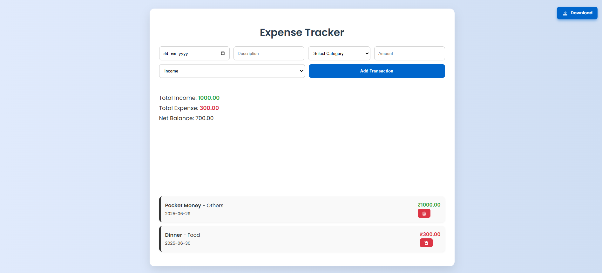

# Expense Tracker

A simple web app to track your **income** and **expenses**. Built with HTML, CSS, and JavaScript. It stores data locally, shows totals, and includes a pie chart using Chart.js.

---

## ✨ Features

- Add income and expense entries
- Choose categories like Food, Transport, etc.
- View total income, expenses, and net balance
- See a live **pie chart** (Income vs Expense)
- Download your data as an Excel file
- Works offline (data saved in browser)
- Responsive layout (mobile + desktop)

---

## 📂 Files

- `index.html` – Page layout and structure  
- `style.css` – App styling  
- `script.js` – Logic and chart rendering  
- `README.md` – This file  

---

## 🚀 How to Use

1. Download or clone the project
2. Open `index.html` in a browser
3. Add your transactions (date, amount, category, etc.)
4. Use the **Download** button to export your data as Excel

---

## 📦 Tools Used

- **HTML + CSS + JavaScript**
- **Local Storage** – To save your data
- **SheetJS** – For Excel export feature

---

## 📸 Screenshot

